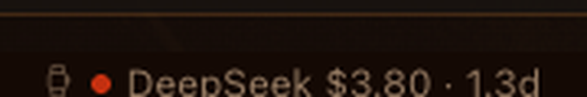

# Burnclock for Hermes

A Hermes Desktop status-bar chip that shows the provider balance and runway
tracked by [burnclock](https://pypi.org/project/burnclock/) — an MIT-licensed,
local-first CLI for answering “how much is left, and how long will it last?”



`DeepSeek $3.80 · 1.3d` is one line from burnclock's cache: provider, remaining
balance, and estimated runway at the current burn rate. The dot is green above
five days, amber under five, red under two.

## What it does

- Adds a small watch chip to `statusBar.right`.
- Every 60 seconds it reads burnclock's cache files (`badge.txt` for the line,
  `badge.json` for status and runway). It never spawns the CLI.
- Clicking the chip shows the full reading (provider, balance, runway, cache
  timestamp) and re-reads the cache.
- When there is no cache yet, it shows `burnclock —` and explains how to
  populate one. It never invents a number.

## Requirements

- Hermes Desktop **0.22.0 or newer**.
- The **burnclock CLI** installed with `pip install burnclock` (0.1.2+) or pipx,
  to populate the cache. The plugin does not need the CLI on its `PATH`; it
  reads the cache files directly.
- Burnclock configured with at least one provider key, and one successful
  `burnclock badge --refresh` so a cache exists.

The plugin does **not** install the CLI, ask for keys, or configure providers.
That separation is deliberate: credentials stay with burnclock, not in a
renderer plugin.

## Install

From the catalog (after listing):

```bash
hermes plugins install burnclock
```

Manual install, for development:

```bash
git clone https://github.com/jersilb/burnclock-hermes
mkdir -p ~/.hermes/desktop-plugins/burnclock
cp burnclock-hermes/desktop/plugin.js ~/.hermes/desktop-plugins/burnclock/plugin.js
```

Then reload the Desktop plugins (⌘K → “Reload desktop plugins”, or restart the
app). The chip appears at the right end of the status bar.

Populate the first reading in a normal terminal, where your provider keys are
available:

```bash
pip install burnclock
burnclock badge --refresh
```

## What it reads, and what it does not

**Reads:** burnclock's own cache files, resolved the same way the CLI resolves
them (`$BURNCLOCK_BADGE_CACHE`, then `$XDG_CACHE_HOME/burnclock/badge.json`,
then `~/.cache/burnclock/badge.json`). `badge.txt` supplies the one-line label;
`badge.json` supplies the provider row, status, runway and timestamp.

**Does not read:** environment files, `~/.hermes/.env`, Hermes credentials,
provider keys, browser profiles, or any file outside burnclock's own cache.
It has no telemetry, no analytics, no update checker, and makes no network
calls itself.

**Shell command:** each refresh runs exactly one command via the Desktop SDK's
`shell.exec`: a `cat` of those two cache files, bound to the active session. It
never executes the burnclock CLI, so it cannot trigger a collection or write to
the cache. Populating the cache stays a user action in their own terminal,
where their provider keys are available.

## Notes

- This is a read-only view. “Estimates, not billing truth” applies: burnclock
  converts balances to runway using published rate cards, and actual billing
  can differ.
- The chip is cache-first by design. If the cache is stale, it shows the last
  known line rather than blocking the status bar on a network call.
- Uninstall by removing the plugin in Settings → Plugins, or deleting the
  plugin folder.

## License

MIT. The burnclock CLI is a separate MIT project; this repository contains only
the Hermes Desktop plugin and its documentation.
